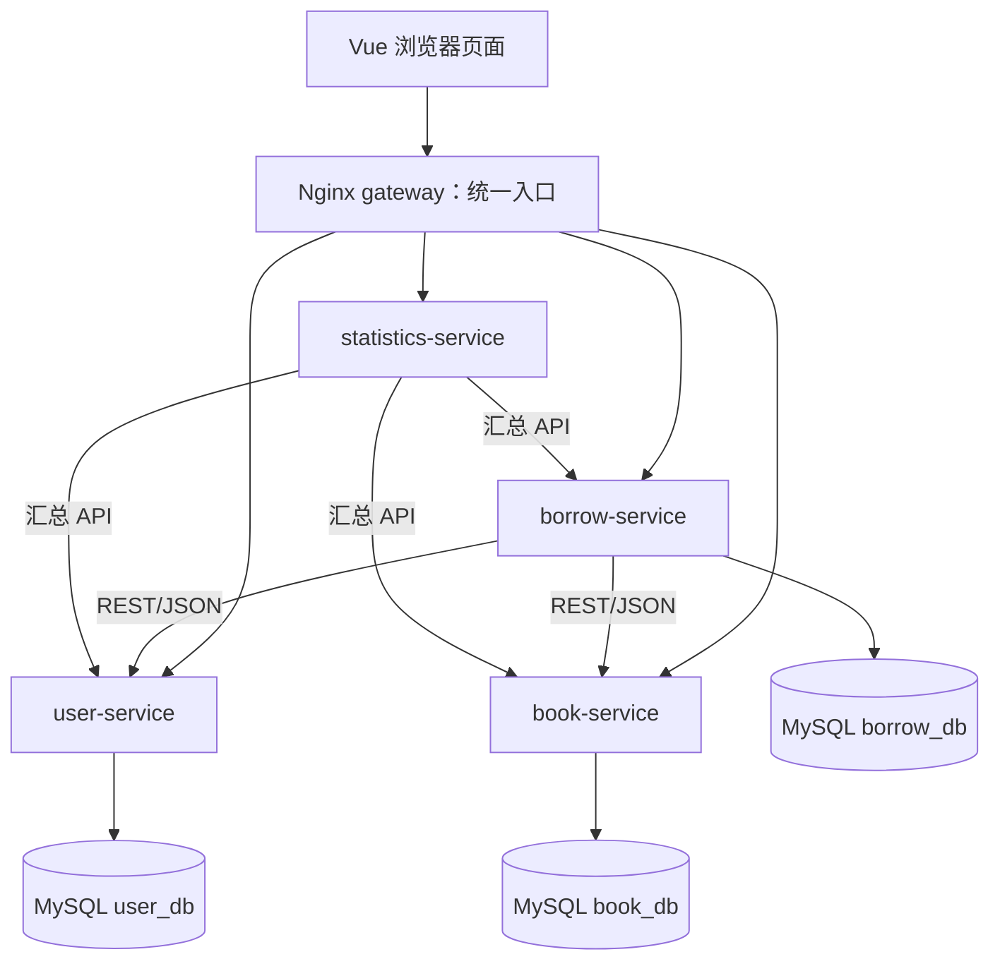

# 基于微服务架构的图书管理系统

“微服务与云原生技术实践”课程专业实习项目。当前版本完成课程必做的用户、图书、借还、五项业务统计与 Docker Compose 联动；项目仍以课程验收和演示为目标。**Redis、Prometheus、Grafana、Kubernetes、Istio 未纳入当前实现范围。**

## 项目背景与目标

图书借阅涉及账户权限、书目库存、借还记录和管理统计。项目将这些职责拆为四个独立 Django 服务，使用 RESTful API 与 JSON 协作，前端通过 Nginx 统一入口访问。目标是现场展示可运行的业务流程、后端授权、MySQL 数据所有权和多容器通信，而非仅展示微服务目录。

## 功能与系统角色

| 角色 | 已实现功能 |
| --- | --- |
| 普通用户 `USER` | 注册、登录、查看/修改本人资料；查询图书、查看详情；借书、查看本人借阅和还书 |
| 管理员 `ADMIN` | 以上功能及用户管理、分类管理、书目/库存管理、全站借阅查询、五项基础统计 |

用户和图书的 DELETE 为**归档**，保留历史 ID 与借阅快照；分类未被图书引用时可删除。用户、分类和图书管理支持 CRUD。书目查询支持精确、条件、模糊、复合查询、分页和排序。前端对用户、图书、分类删除先弹出二次确认；最终权限和数据校验均由后端执行。

## 技术栈

| 层次 | 当前实际使用 |
| --- | --- |
| 前端 | HTML、CSS、JavaScript（由 TypeScript 构建生成）、TypeScript、Vue 3、Vue Router、Pinia、Axios、Element Plus、ECharts、Vite |
| 后端 | Python、Django、Django REST Framework、Django ORM、Simple JWT |
| 数据与认证 | MySQL 8.4；RS256 JWT access/refresh；密码采用 Django 哈希 |
| 架构与部署 | RESTful API、JSON、四个独立微服务、Nginx gateway、Docker、Docker Compose、Git |

## 系统架构与微服务划分



gateway 将 `/api/v1/auth` 与 `/api/v1/users` 转给 user-service，图书与分类转给 book-service，借阅转给 borrow-service，统计转给 statistics-service。borrow-service 通过受保护的 user/book API 核验用户、查询图书和更改库存；statistics-service 调用三个业务服务的汇总 API，不连接它们的数据库。详见 [当前架构](docs/architecture.md)。

| 服务 | 职责 | 自有业务库 |
| --- | --- | --- |
| user-service | 用户、角色、账户状态、JWT | `user_db` |
| book-service | 分类、书目、库存及幂等库存操作 | `book_db` |
| borrow-service | 借阅记录、借还协调与恢复 | `borrow_db` |
| statistics-service | 聚合五项业务统计，供 Dashboard/ECharts 使用 | 无 |

MySQL 使用**一个实例、三个逻辑库、三个专用业务账户**。跨服务只保存 UUID 和必要快照，不直接访问对方表。数据库模型、约束与迁移见 [数据库设计](docs/database.md)。

## 项目目录

```text
frontend/                    Vue 3 + TypeScript 页面、API、路由、Store
gateway/                     Nginx 统一入口配置与 Dockerfile
services/user-service/       独立 Django 用户服务，开发端口 8001
services/book-service/       独立 Django 图书服务，开发端口 8002
services/borrow-service/     独立 Django 借阅服务，开发端口 8003
services/statistics-service/ 独立 Django 统计服务，开发端口 8004
deploy/docker/               Django 镜像与 MySQL 初始化脚本
deploy/{prometheus,grafana,kubernetes,istio}/ 仅存未来扩展说明，无可部署配置
scripts/                     本地配置生成与分阶段验证脚本
docs/                        当前总览、历史阶段记录、测试与演示材料
docker-compose.yml           七个当前组件的 Compose 定义
.env.example                 无真实密码的配置模板
```

## RESTful API 与 JWT

公共请求和响应使用 JSON，路径以 `/api/v1` 开头，浏览器只需访问 gateway 一个端口。主要资源：`/auth/*`、`/users`、`/categories`、`/books`、`/borrows`、`/statistics/overview`。接口方法、参数、权限、返回值和状态码见 [API 文档](docs/api.md)。常见状态码为 200/201/204、400 校验失败、401 未认证、403 无权限、404 不存在、409 业务冲突、503 上游不可用。

user-service 签发 RS256 JWT；浏览器通过 Axios 请求拦截器附加 Bearer access。Vue Router 守卫区分角色；后台仍对每次请求验证权限。管理员敏感操作会向 user-service 核对**当前**角色和账户状态。私钥、数据库密码和服务凭据只从未提交的本地环境配置读取。

## 本地启动（Windows PowerShell）

需要 Python 3.11+、Node.js、Docker Desktop。以下命令在项目根目录执行；配置脚本不会覆盖已存在的 `.env`。详情见 [本地 MySQL 开发说明](docs/phase-2/mysql-development.md)。

```powershell
python -m venv .venv
foreach ($service in @('user-service','book-service','borrow-service','statistics-service')) {
  .\.venv\Scripts\python.exe -m pip install -r "services\$service\requirements.txt"
}
.\.venv\Scripts\python.exe scripts\setup_dev_env.py
.\.venv\Scripts\python.exe scripts\setup_user_jwt.py
.\.venv\Scripts\python.exe scripts\setup_book_auth.py
.\.venv\Scripts\python.exe scripts\setup_borrow_auth.py
.\.venv\Scripts\python.exe scripts\setup_statistics_auth.py
docker compose up -d --wait mysql
docker compose exec -T mysql bash /docker-entrypoint-initdb.d/01-databases.sh
.\.venv\Scripts\python.exe services\user-service\manage.py migrate --noinput
.\.venv\Scripts\python.exe services\book-service\manage.py migrate --noinput
.\.venv\Scripts\python.exe services\borrow-service\manage.py migrate --noinput
```

分别在四个终端从根目录启动服务：

```powershell
.\.venv\Scripts\python.exe services\user-service\manage.py runserver 127.0.0.1:8001
.\.venv\Scripts\python.exe services\book-service\manage.py runserver 127.0.0.1:8002
.\.venv\Scripts\python.exe services\borrow-service\manage.py runserver 127.0.0.1:8003
.\.venv\Scripts\python.exe services\statistics-service\manage.py runserver 127.0.0.1:8004
```

前端在 `frontend/` 执行 `Copy-Item .env.example .env`、`npm install`、`npm run dev`，访问 `http://127.0.0.1:5173/`。Vite 本地代理按路径连接四个开发端口。本地首次管理员可用 user-service 的 `manage.py createsuperuser` 交互创建。

## Docker Compose 启动与停止

完成上述本地配置生成后，在根目录执行：

```powershell
docker compose config --quiet
docker compose build
docker compose up -d --wait --wait-timeout 180
docker compose ps
```

默认统一访问地址为 `http://127.0.0.1:8080/`；如端口占用，在根目录未提交的 `.env` 配置 `GATEWAY_PORT`。MySQL volume 为 `library-dev_mysql-data`。日常停止使用 `docker compose down`，保留数据；不要把 `down -v` 当作停止命令。各容器作用、网络和常见 Docker 问题见 [Docker 文档](docs/docker.md)。

## 测试方式与已知结果

```powershell
Set-Location frontend
npm run build
Set-Location ..
docker compose config --quiet
docker compose build
docker compose up -d --wait --wait-timeout 180
docker compose exec -T user-service python manage.py check
docker compose exec -T book-service python manage.py check
docker compose exec -T borrow-service python manage.py check
docker compose exec -T statistics-service python manage.py check
$env:PHASE10_GATEWAY_URL='http://127.0.0.1:8080' # 按实际端口修改
.\.venv\Scripts\python.exe scripts\verify_phase10_compose.py
```

阶段 14 实测四服务 Django 测试 **140/140** 通过、前端构建通过、七个核心容器 healthy、Docker gateway 完整业务流程通过。分项命令、浏览器验证、问题及修复见 [完整测试报告](docs/test-report.md)。课程逐项对应见 [验收清单](docs/acceptance-checklist.md)。

## 项目截图与课程材料

真实系统截图的存放位置和建议文件名见 [docs/screenshots/README.md](docs/screenshots/README.md)；当前仓库未预置截图。现场使用 [12–14 分钟演示脚本](docs/demo-guide.md)，答辩准备见 [常见问题与回答](docs/qa.md)，最终状态见 [final-status.md](docs/final-status.md)。

## 常见问题、限制与扩展

- **页面可打开但接口失败**：检查 `docker compose ps`、`docker compose logs --tail 100 <service>`，并运行完整业务脚本；网关自身健康检查不覆盖全部上游。
- **MySQL 密码不一致**：已有 volume 的账户密码不会因修改 `.env` 自动更新；核对服务 `.env` 与根目录配置，勿删除现有业务数据来掩盖配置问题。
- **端口冲突**：在根目录 `.env` 设置 `GATEWAY_PORT` 或 `MYSQL_PORT`；容器之间仍使用 Compose 服务名。
- **当前限制**：单 MySQL 实例、同步统计聚合、借还部分失败需按原操作号核对/恢复；前端构建有大 chunk 提示。项目面向课程验收，未实现生产级高可用。
- **未来扩展**：Redis 缓存、Prometheus/Grafana 监控、Kubernetes 编排、Istio 服务网格均需另行设计与验证；目前没有对应运行组件。五项基础统计是业务数据展示，不等同于运行监控。

阶段历史资料位于 `docs/phase-1/` 至 `docs/phase-13/`，其中提到的早期扩展计划按当时阶段保留；当前实现和验收范围以本 README 及 `docs/` 根目录的最终文档为准。
