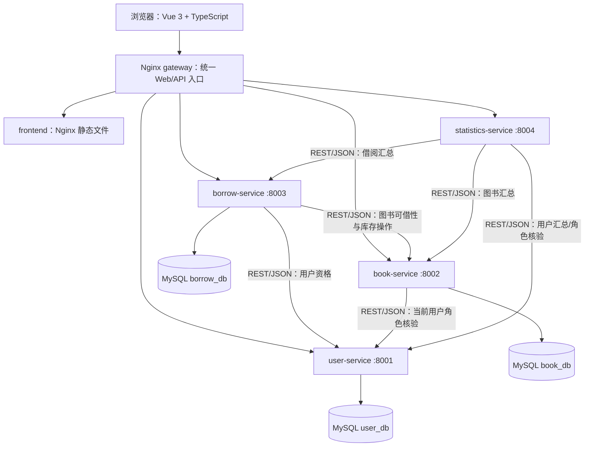

# 当前系统架构

本页描述已经实现并通过 Docker 联调的结构。阶段 1 的早期设计留在 [phase-1/architecture.md](phase-1/architecture.md) 作为历史资料。

三个逻辑库位于同一个 MySQL 8.4 容器，但各有专用账户和权限。statistics-service 没有业务数据库，也不跨服务直接读表。book-service 中的 `Book.category` 和 `StockOperation.book` 是其**自有库内部**的外键；borrow-service 只存跨服务 `user_id`、`book_id` 及必要的展示快照，不建立跨库外键。

## 入口与通信

- 浏览器只访问 gateway。Nginx 把 `/api/v1/auth`、`/api/v1/users` 转给 user-service，`/api/v1/books`、`/api/v1/categories` 转给 book-service，`/api/v1/borrows` 转给 borrow-service，`/api/v1/statistics` 转给 statistics-service；其余路径交给 frontend 的 Vue 路由回退。
- 服务间 URL 从环境变量加载。Compose 内使用 `http://user-service:8001`、`http://book-service:8002` 等服务名；容器中的 `localhost` 只指本容器。
- gateway 使用 Docker DNS `127.0.0.11` 动态解析上游，避免服务容器重建后固定旧 IP。`/gateway/health` 仅检测网关自身，业务可用性仍需跑完整 HTTP 流程。
- 公共接口使用 JSON。内部接口只在 Compose 网络中按服务地址调用，并使用独立服务凭据；网关没有向浏览器转发 `/internal/v1/`。

## 身份与业务调用

user-service 签发 RS256 access/refresh JWT；其余服务持有公钥验证签名。管理员写操作和统计访问还会经 user-service 的内部接口核对当前账户、状态和角色，不能仅相信可能过时的 `role` 声明。用户密码由 Django 哈希；私钥、数据库密码和服务凭据存在未提交的 `.env` 配置中。

借书链路：浏览器 → gateway → borrow-service → user-service 核验当前用户 → book-service 查询可借性 → book-service 原子预留一册 → borrow-service 完成借阅记录。还书链路反向释放一册。网络结果不明时保留 `PENDING` / `RETURN_PENDING`，按同一操作号查询并恢复，不盲目换号重试；详情见 [借还流程](phase-5/workflow.md)。

统计链路：管理员 → gateway → statistics-service → user/book/borrow 三个服务的受保护汇总 API。每个业务服务只聚合自己的库，statistics-service 组合五项数字和 ECharts `labels`/`values`。上游故障返回 503，不伪造零值。

## 部署范围

当前使用 Docker Compose 的七个容器：frontend、gateway、四个 Django 服务、mysql。Redis、Prometheus、Grafana、Kubernetes、Istio 均为**当前课程版本未纳入实现范围的扩展功能**。
