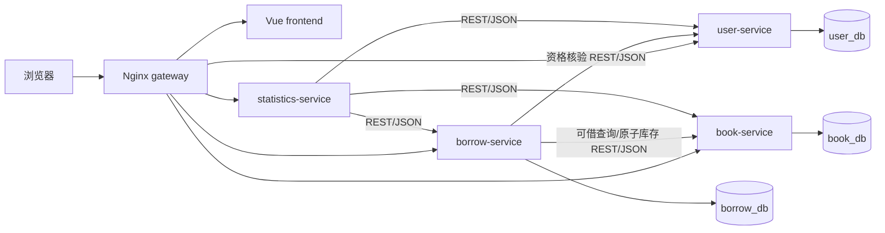
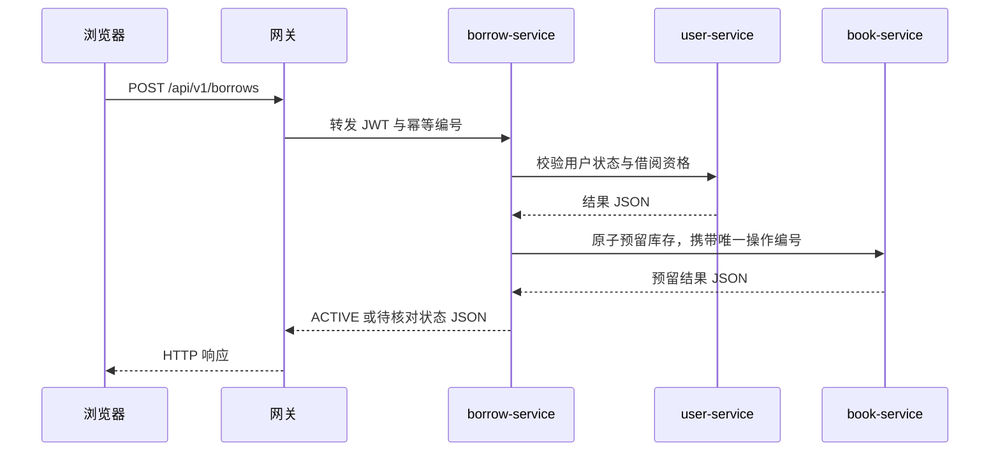

# 阶段 1：总体架构与服务边界

> 阶段 10 范围修订：当前部署仅包含 Vue、Nginx 网关、四个 Django 服务与 MySQL。阶段 9 暂缓 Redis/NoSQL 缓存；阶段 10 暂缓 Prometheus、Grafana、Kubernetes 与 Istio。以下保留的相关早期设想只作未来可选扩展，不属于当前验收。

## 设计目标

四个 Django REST Framework 服务分别运行、部署和迁移，通过受保护的 REST/JSON 接口协作；Vue 3 + TypeScript 提供统一 Web 界面；Nginx 提供单一外部入口。当前课程验收聚焦业务闭环、权限与可复现的 Docker Compose 部署。

## 责任与数据所有权

| 服务 | 拥有 | 向其他服务提供 | 不承担 |
| --- | --- | --- | --- |
| user-service | 用户、密码哈希、角色、账户状态、JWT 签发 | 用户是否可借、管理员权限与聚合统计 | 图书库存、借阅记录 |
| book-service | 分类、图书、库存、幂等库存操作 | 图书详情、原子预留/归还、图书与可借库存汇总 | 用户身份、借阅历史 |
| borrow-service | 借阅记录、借还状态与跨服务协调 | 借阅列表、已借册数与当前借阅数汇总 | 直接修改其他服务数据库 |
| statistics-service | 五项概览统计 API；当前不持久化业务数据 | 管理员五项概览汇总 | 独占业务事实、跨库查询 |

服务之间只通过 API 读取对方的数据。一个 MySQL 实例中建立 `user_db`、`book_db`、`borrow_db`，每个服务使用只具有自己库权限的账户。`statistics-service` 初期无 MySQL 数据库。这是按服务分库的简化部署：逻辑边界清楚，但 MySQL 实例仍是共同的故障点。

## 前端页面与技术安排

HTML/CSS 构成页面与布局，JavaScript/TypeScript 承载交互；项目代码优先使用 TypeScript。Vue 3 使用 Composition API 与 `<script setup lang="ts">`，Vue Router 管页面，Pinia 管登录用户与必要的共享状态，Axios 统一发送 API 请求与显示错误，Element Plus 提供表单、表格和删除确认，ECharts 展示业务统计。

| 页面 | 普通用户 | 管理员 |
| --- | --- | --- |
| 登录、注册、个人资料 | 可用 | 可用 |
| 首页、图书列表、详情、搜索、我的借阅 | 可用 | 可用 |
| 用户管理、图书管理、分类管理、借阅管理 | 不可用 | 可用 |
| 统计分析、系统运行 | 不可用 | 可用 |

普通用户和管理员共享图书页面，不复制两套相同实现。页面显隐及路由守卫不代替后端权限校验。新增与编辑表单在前端给出及时提示，后端再次校验；所有删除按钮在真正发出请求前要求二次确认。

## 对外路径与调用

网关对外开放 `/`（前端）与 `/api/v1/...`（四服务 API），按路径转发。前端的 Axios `baseURL` 使用相对路径，不包含容器名。服务间使用由环境变量配置的 Compose 服务 DNS 名称与内部接口。网关不代替后端鉴权。

图示仅表达依赖；实际借还状态、部分失败与恢复规则见[借还流程](borrow-workflow.md)。内部库存 API 不经浏览器暴露。借还写调用由应用层幂等处理，不能无条件开启网格或 HTTP 客户端自动重试。

阶段 5 已实现的实际调用链为：借阅服务本地验签 → 用户服务资格核验 → 图书服务可借预检查 → borrow_db 持久化 PENDING → 图书服务按原操作号查询/预留 → 确认后本地 ACTIVE。归还则先在 borrow_db 持久化 RETURN_PENDING，按原释放号核对/释放后本地 RETURNED。远程结果不明保留待处理记录，由恢复命令继续核对；详见[阶段 5 实际流程与测试](../phase-5/workflow.md)。图书、用户、借阅服务之间没有跨库访问或跨库外键。

阶段 6 概览调用链为：statistics-service 本地验证管理员 JWT → user-service 核实账户当前状态与角色 → 分别调用 user-service、book-service、borrow-service 的受保护汇总接口 → 返回五项统计和 ECharts 数组。每个业务服务仅聚合自己的数据库；统计服务没有业务库，一次请求不会按书或用户循环调用。任何必要上游不可用均返回 503。具体口径见[阶段 6 统计 API](../phase-6/statistics-api.md)。

## 认证与权限

`user-service` 持有 JWT 签名私钥，其他服务通过配置的验证公钥校验签名、到期时间和必要声明。令牌中的 `sub` 为不可变用户 ID，`role` 只用于初步授权；管理员写操作和借书资格等敏感动作还调用用户服务确认账户及当前角色，防止角色变更后旧令牌继续获得敏感权限。注册接口只创建普通用户。密码由 Django 哈希机制保存。

服务间内部 API 使用独立的服务身份凭据，由未提交的本地环境变量注入；普通用户 JWT 不能直接调用库存操作和聚合内部 API。公开借阅记录查询必须按 JWT `sub` 过滤；管理员全量查询需要后端管理员权限。服务不可用时相关写操作返回明确的暂不可用结果，不绕过校验。

## 开发与部署视图

项目根目录就是当前 `Book_management_system/`，不再嵌套一层同义目录。阶段 2 计划建立 `frontend/`、`gateway/`、`services/{user-service,book-service,borrow-service,statistics-service}/`、`deploy/{docker,kubernetes,prometheus,grafana,istio}/`、`docs/`、`.env.example` 与 `docker-compose.yml`。本阶段仅创建规划文档，不创建空服务或假配置。

Compose 中只公开网关业务入口；前端、网关与四个 Django 服务构建镜像，MySQL 使用明确版本镜像。服务用容器 DNS 名通信，MySQL 使用持久卷，并配置健康检查及迁移步骤。当前不部署 Redis、Prometheus 或 Grafana。业务五项统计由 ECharts 页面展示。

历史扩展设想：未来若重新启动 Kubernetes 阶段，可为无状态组件提供 Deployment 和 Service，以 ConfigMap/Secret 注入配置，并为 MySQL 配置持久存储；若再启动 Istio 阶段，可针对内部只读调用展示网格路由。上述内容当前暂缓，阶段 10 不创建相应清单或容器。

历史规划曾考虑为图书查询及概览增加 Redis 可重建缓存。阶段 9 用户将其移出当前版本；若未来另行实施，仍须保持 MySQL 数据所有权和跨服务 API 边界。

## 非目标与主要风险

当前不设计消息队列、跨库事务、复杂熔断、多集群、金丝雀发布或生产级高可用。主要风险依次是库存并发与跨服务部分失败、权限令牌过期/角色变化、容器服务地址配置、迁移和持久化。相关失败必须通过接口状态、日志和测试说明，不能静默吞掉。
