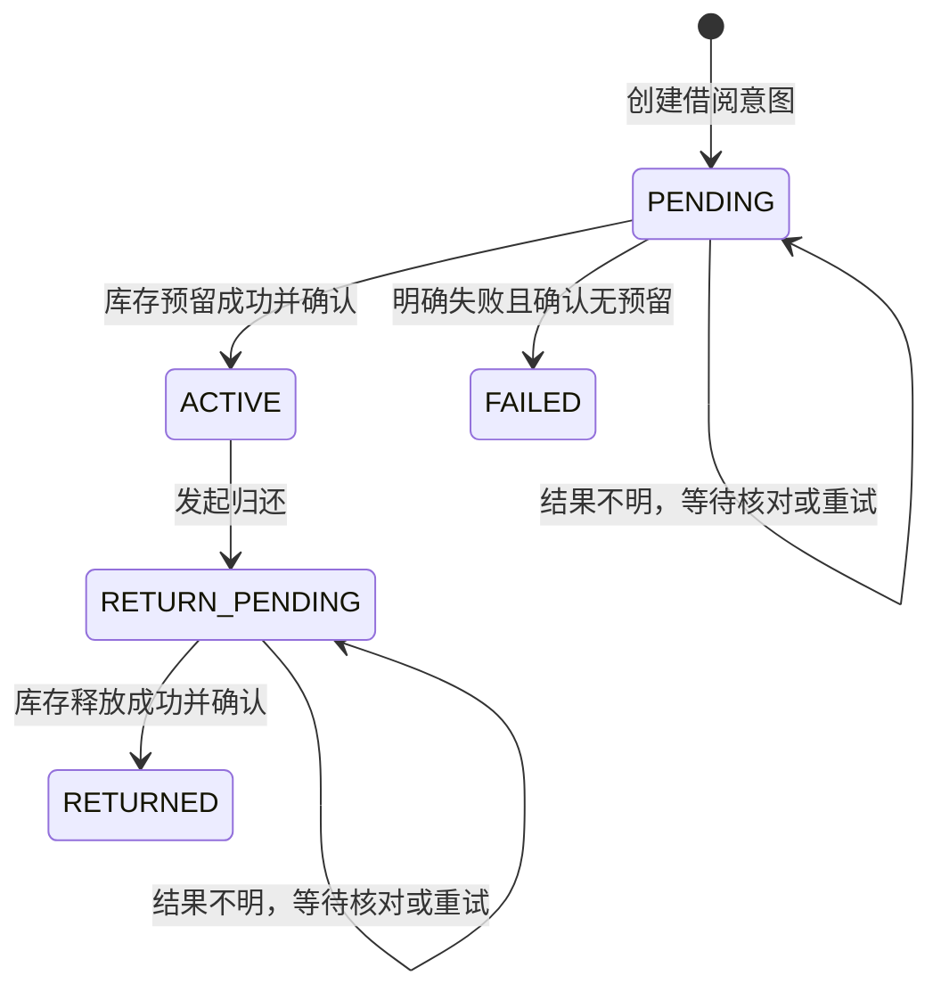

# 阶段 1：借还状态机、一致性与故障处理

跨服务没有统一数据库事务。`borrow-service` 是业务协调者，`book-service` 独占库存真值。目标是保证**不超借、不重复扣减、不重复归还、故障后可核对与恢复**。单个服务内部使用本地数据库事务；跨服务使用幂等 API、待处理状态和补偿/核对流程。

## 核心不变量

1. 每本书始终满足 `0 <= available_copies <= total_copies`。
2. 同一个借阅 ID 最多成功预留一册、最多成功归还一册；操作编号和 `(borrow_id, book_id, kind)` 唯一。
3. `ACTIVE` 借阅必须对应成功的库存预留；`RETURNED` 借阅必须对应成功归还；网络状态不明时不能猜测成功或失败。
4. 只有 `book-service` 可修改其 MySQL 库中的库存；`statistics-service` 不作库存写入。当前版本不使用 Redis。
5. 前端重复点击、HTTP 超时和服务重启不能导致第二次库存变更。

## 借书状态流

1. 浏览器提交 `book_id` 与唯一 `Idempotency-Key`。`borrow-service` 验证 JWT，并从 `user-service` 核对当前账户有效性与借阅资格。若规则最终包含借阅上限，先在借阅服务内校验并以事务处理并发争抢。
2. `borrow-service` 以唯一请求编号创建 `PENDING` 记录。相同编号的重复请求返回同一借阅结果或处理中状态。
3. 调用 `book-service` 预留接口，传借阅 ID 与唯一操作编号。`book-service` 在一个本地事务中检查图书是否存在、未归档及 `available_copies > 0`，原子减一并写入成功操作记录；不满足时返回明确冲突且不扣减。重复操作编号返回原结果。
4. `borrow-service` 收到确定的预留成功后把记录改为 `ACTIVE` 并写入借出/应还时间。仅此时对用户报告借书完成，并计入成功借阅统计。
5. 预留调用超时或响应丢失时保持 `PENDING`，按操作编号查询图书服务的操作结果。确定成功则完成 `ACTIVE`；确定未执行则安全重试或结束；依赖不可用时交由恢复任务继续核对，不新建第二次预留。

若库存预留成功但借阅服务最终无法确认记录，必须先确认一次且仅一次的释放操作完成，才可将借阅标为 `FAILED`。不能在结果未知时盲目释放或再次扣减。

## 还书状态流

1. 本人或管理员对 `ACTIVE` 借阅发起归还，带唯一幂等编号。借阅服务以本地事务将记录变为 `RETURN_PENDING`；对 `RETURNED` 的重复归还直接返回既有结果。
2. 借阅服务调用图书服务的归还接口。图书服务先确认该借阅曾成功预留且尚未释放，再在一个本地事务中将可借册数加一并记录释放操作。重复请求只返回原结果，不再次加一。
3. 收到明确成功后，借阅服务将记录变为 `RETURNED` 并写入归还时间。响应不明时保持 `RETURN_PENDING`，按操作编号核对后继续完成，不根据超时推断失败。
4. 若账户后来被停用或图书被归档，已有借阅仍应允许按授权流程归还。

## 恢复任务与人工排查

阶段 5 提供可重复执行的恢复入口，扫描超过短暂处理窗口的 `PENDING` 和 `RETURN_PENDING` 记录，查询图书服务操作状态，并按上面的状态转换补全。恢复入口同样遵守幂等规则；失败可再次运行。长期未解决的记录暴露在管理员借阅管理页或运行信息中，并记录关联 `request_id`，供人工排查。统计结果不把待处理记录当作已完成借还。

## 失败场景与预期结果

| 场景 | 对外结果 | 数据处理及验证 |
| --- | --- | --- |
| 未登录、越权 | 401、403 | 不创建借阅、不修改库存 |
| 用户不存在或停用 | 404 或 403 | 不创建有效借阅、不修改库存 |
| 图书不存在或已归档 | 404 或 409 | 记录可标 `FAILED`，库存不变 |
| 库存为零、并发争最后一册 | 409 | 原子条件更新仅允许一笔成功；总库存不为负 |
| 前端重复提交相同编号 | 返回同一结果或处理中 | 借阅记录与预留操作各只有一笔 |
| 图书服务执行成功但响应丢失 | 处理中，随后可查询 | 按操作编号核对后转 `ACTIVE`；库存不重复扣减 |
| 归还请求执行成功但响应丢失 | 处理中，随后可查询 | 按操作编号核对后转 `RETURNED`；库存不重复增加 |
| 用户服务或图书服务不可用 | 503 或处理中 | 不绕过校验；恢复后继续同一操作 |
| 试图归还他人借阅 | 403 | 状态与库存不变 |

## 验收测试

正常借还测试检查借阅状态和库存变化；反例测试覆盖上述所有失败场景。并发测试以最后一册同时发起至少两个借书请求，只允许一个成功。故障测试在库存操作完成后模拟响应丢失或服务重启，恢复后核对库存、操作日志和借阅状态一致。测试必须查询两个服务各自的 API 或数据库证明结果，不能仅检查页面提示。

阶段 5 经用户确认：借期 30 天、最多同时借阅 5 本，逾期不自动罚款且仍允许归还；PENDING、ACTIVE、RETURN_PENDING 计入上限。实际接口、恢复命令和验证见[阶段 5 借还流程](../phase-5/workflow.md)。本文件其余内容保留阶段 1 设计基线。
